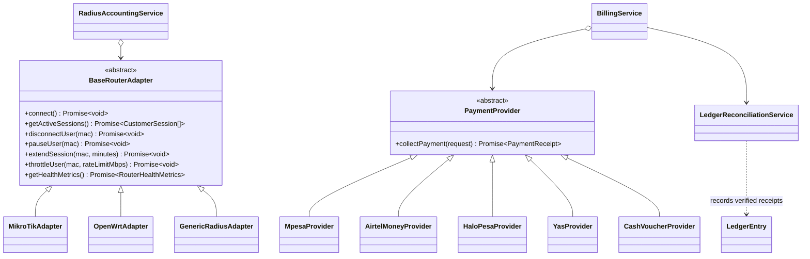

# Project IG

A local-first hotspot management starter: a practical TZS sales ledger, active-session view, router status panel, and an OOP TypeScript service core.

## Run locally

Requirements: Node.js 22.18 or newer and pnpm. The dashboard includes a PWA manifest and a small offline shell cache for previously visited assets.

```powershell
pnpm install
pnpm dev
```

Open [http://localhost:3000](http://localhost:3000). The API listens on [http://localhost:4000](http://localhost:4000). The web dashboard includes local sample data when the API is not running; with the API running it uses HTTP and Socket.IO for session state and controls.

Useful commands:

```powershell
pnpm dev:api
pnpm dev:web
pnpm build
```

Copy `apps/api/.env.example` to `apps/api/.env` to change the API port or dashboard origin.

## Deploy the web app to GitHub Pages

The `main` branch deploys the static web dashboard through [`.github/workflows/deploy.yml`](.github/workflows/deploy.yml). In the repository, open **Settings → Pages** and choose **GitHub Actions** as the publishing source. After the workflow succeeds, the project site is available at <https://ypmulima-11.github.io/PROJECT-IG/>.

GitHub Pages serves static files, so this deployment uses the bundled sample data. Session controls, custom plans, and generated voucher previews are interactive and saved in the current browser only. Voucher codes are not activated on a router or shared with another operator. The hosted site does not run the API, database, or router integrations.

## Architecture blueprint



The adapters hide router-specific commands behind one contract. The accounting service owns session operations and delegates to the adapter registered for each location. Payment providers return a verified receipt; billing passes it to ledger reconciliation, which applies reference-level idempotency before creating an immutable ledger entry. Domain entities hold business state; Express controllers only translate HTTP requests and responses.

### Project structure

```text
apps/
  api/
    src/
      domain/entities/       # Location, session, plan, voucher batch, ledger
      domain/ports/           # Repository contracts
      infrastructure/demo/   # Explicit in-memory fixtures and store
      infrastructure/payments/ # Polymorphic provider implementations
      infrastructure/routers/  # MikroTik, OpenWrt, generic RADIUS adapters
      services/                # Billing, RADIUS accounting, reconciliation
      http/                    # REST API and Socket.IO composition
  web/
    app/                       # Next.js App Router, PWA manifest, and styling
    components/                # Dashboard and customized local UI primitives
      ui/                      # Shadcn-style Button and shared controls
    lib/                       # API client, types, fallback demo snapshot
    public/                    # PWA icon and runtime service worker
database/
  schema.sql                   # PostgreSQL and FreeRADIUS-aligned schema
docs/
  architecture.md              # Boundaries, UML notes, rollout seams
```

## HTTP surface

| Method | Path | Purpose |
| --- | --- | --- |
| `GET` | `/api/health` | API health |
| `GET` | `/api/dashboard` | Ledger totals, router health, sessions, traffic series |
| `GET` | `/api/sessions` | Current active and paused sessions |
| `POST` | `/api/sessions/:mac/disconnect` | Disconnect a client |
| `POST` | `/api/sessions/:mac/pause` | Pause a client |
| `POST` | `/api/sessions/:mac/resume` | Resume a paused client |
| `POST` | `/api/sessions/:mac/extend` | Extend a session (`{"minutes":60}`) |
| `POST` | `/api/sessions/:mac/throttle` | Set speed cap (`{"rateLimitMbps":2}`) |
| `POST` | `/api/payments/collect` | Collect a demo payment and record its ledger entry |

Socket.IO publishes `dashboard:snapshot` every five seconds. The fixtures use Tanzania context and realistic-format phone/MAC addresses, but all gateway success is simulated locally. Do not treat this demo provider as proof of a real mobile-money transaction.

## Data and production seams

`database/schema.sql` is the PostgreSQL target, including separate operational tables and FreeRADIUS-compatible `radcheck`, `radreply`, and `radacct` tables. The runnable API uses in-memory repositories so it needs no database or Redis service. Replace those demo repositories with PostgreSQL implementations, add Redis-backed live counters, and wire authenticated MikroTik/OpenWrt and payment-provider clients before operating real hotspots. Real provider integrations must verify signed callbacks/provider transaction status before reconciliation writes a verified `LedgerEntry`.

### PostgreSQL schema

See [`database/schema.sql`](database/schema.sql). Entity relationships, operational boundaries, and migration notes are in [`docs/architecture.md`](docs/architecture.md).

